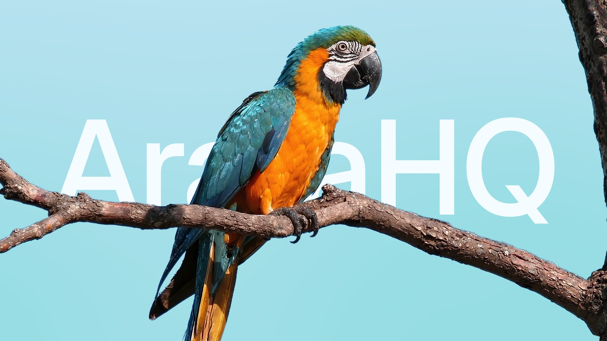

<p align="center">
  
</p>

<h3 align="center">Communication infrastructure for Latin America</h3>

<p align="center">
  <a href="https://ararahq.com">Website</a> &bull;
  <a href="https://docs.ararahq.com">Docs</a> &bull;
  <a href="https://docs.ararahq.com/quickstart">Quickstart</a> &bull;
  <a href="https://x.com/ararahq">X</a>
</p>

---

### What is Arara?

Arara is the **developer-first WhatsApp API** for Latin America. Integrate in 5 minutes. Send templates, campaigns, and build conversational flows — all through a simple, clean API.

```typescript
import { NodeSDK } from '@ararahq/sdk';

const arara = new NodeSDK({ apiKey: 'ara_live_...' });

await arara.messages.send({
  receiver: 'whatsapp:+5511999999999',
  templateName: 'order_confirmation',
  variables: ['João', '#12345']
});
```

### Ecosystem

**AI and agents**

| Project | Description |
|---------|-------------|
| **[pluma](https://github.com/ararahq/pluma)** | Context and export engine for datasets too large for AI, plus Markdown to PDF without Chromium |
| **[mcp](https://github.com/ararahq/mcp)** | MCP server: your AI agent operates your WhatsApp in Claude, Cursor and other agents |
| **[ararahq-code](https://github.com/ararahq/ararahq-code)** | The AraraHQ coding agent |

**SDKs**

| Project | Description |
|---------|-------------|
| **[arara-node-sdk](https://github.com/ararahq/arara-node-sdk)** | Node.js / TypeScript |
| **[arara-python-sdk](https://github.com/ararahq/arara-python-sdk)** | Python (sync + async) |
| **[arara-java-sdk](https://github.com/ararahq/arara-java-sdk)** | Java |
| **[arara-php-sdk](https://github.com/ararahq/arara-php-sdk)** | PHP |
| **[arara-go-sdk](https://github.com/ararahq/arara-go-sdk)** | Go |
| **[arara-ruby-sdk](https://github.com/ararahq/arara-ruby-sdk)** | Ruby |

**Tools**

| Project | Description |
|---------|-------------|
| **[cli](https://github.com/ararahq/cli)** | WhatsApp Business end to end, from the command line |
| **[arara-postman](https://github.com/ararahq/arara-postman)** | Postman collection for the AraraHQ API |
| **[arara-vscode-theme](https://github.com/ararahq/arara-vscode-theme)** | VS Code color theme |
| **[docs](https://github.com/ararahq/docs)** | Source of [docs.ararahq.com](https://docs.ararahq.com) |

### Get Started

```bash
# Install the SDK
npm install @ararahq/sdk

# Or use the CLI
brew install ararahq/tap/arara
arara login
arara send --to +5511999999999 --template hello_world
```

### Built for Developers

- **5 minute integration** — validated by real customers, not marketing
- **6 SDKs** — Node.js, Python, Java, PHP, Go, Ruby
- **CLI with TUI** — interactive terminal dashboard
- **MCP Server** — AI agents send WhatsApp natively
- **Webhooks** — real-time delivery status and inbound messages
- **Sandbox mode** — test with `ara_test_` keys before going live

---

<p align="center">
  <sub>Built in Brazil, for Latin America.</sub>
</p>
